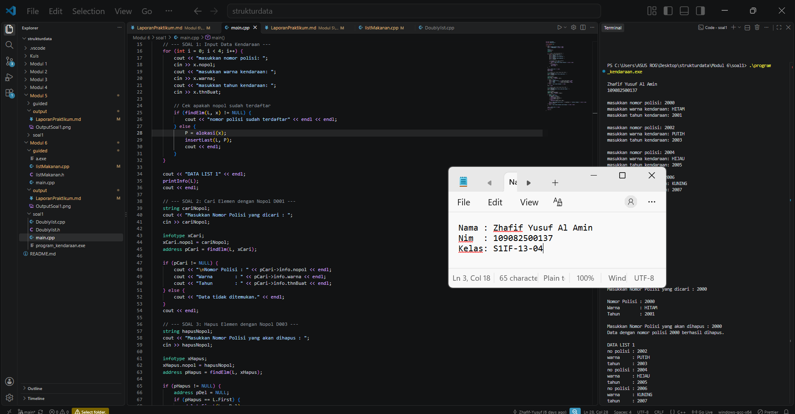

# **Laporan Praktikum MODUL 6 - DOUBLY LINKED LIST (BAGIAN PERTAMA)**

# 


Zhafif Yusuf Al Amin \- 109082500137
## Dasar Teori

### A. Konsep Dasar Doubly Linked List
#### 1. Definisi Doubly Linked List
Doubly linked list (list berkait ganda) adalah struktur data linier yang terdiri dari sekumpulan node yang saling terhubung secara dinamis melalui pointer. Berbeda dengan singly linked list yang hanya memiliki satu pointer penunjuk, setiap node pada doubly linked list memiliki tiga bagian, yaitu bagian data (info), pointer next yang menunjuk ke node sesudahnya, dan pointer prev yang menunjuk ke node sebelumnya. Dengan dua arah pointer ini, penelusuran data dapat dilakukan secara maju maupun mundur.

#### 2. Perbedaan dengan Singly Linked List
Pada singly linked list, node hanya dapat ditelusuri satu arah dari First hingga Nil. Pada doubly linked list, pointer prev memungkinkan akses ke node sebelumnya secara langsung. Hal ini mempermudah operasi penghapusan dan penyisipan di tengah atau di akhir list, karena tidak perlu menelusuri list dari awal untuk mencari node sebelumnya. Selain itu, doubly linked list umumnya menyimpan dua pointer penanda, yaitu First yang menunjuk ke node pertama dan Last yang menunjuk ke node terakhir, sehingga operasi insertLast dan deleteLast dapat dilakukan tanpa menelusuri seluruh list. Kekurangannya, setiap node membutuhkan memori tambahan untuk menyimpan pointer prev, dan pengelolaan pointer menjadi lebih rumit karena ada dua arah yang harus dijaga konsistensinya.

#### 3. Hubungan ADT dengan Struktur Data
Pada praktikum ini, doubly linked list diimplementasikan sebagai Abstract Data Type (ADT) yang dipisah menjadi beberapa file. File Doublylist.h berisi definisi tipe data dan deklarasi fungsi (prototype), Doublylist.cpp berisi implementasi fungsi-fungsi tersebut, dan main.cpp berisi program utama yang memanggil fungsi ADT. Tipe data yang digunakan adalah kendaraan (berisi nopol, warna, dan thnBuat) yang dialiaskan sebagai infotype, struct ElmList sebagai node (berisi info, next, dan prev), serta struct List yang berisi pointer First dan Last. Jika list kosong, First dan Last bernilai NULL. Jika list hanya berisi satu elemen, First dan Last menunjuk ke node yang sama.

### B. Operasi Dasar pada Doubly Linked List
#### 1. Inisialisasi dan Manajemen Memori
Fungsi CreateList mengeset L.First dan L.Last menjadi NULL sehingga list terbentuk dalam kondisi kosong. Fungsi alokasi membuat node baru secara dinamis menggunakan operator new, mengisi info dengan data yang diberikan, serta mengeset next dan prev menjadi NULL. Fungsi dealokasi menghapus node dengan operator delete dan mengeset pointer menjadi NULL agar memori dikembalikan ke sistem dan tidak terjadi kebocoran memori (memory leak).

#### 2. Operasi Penyisipan (Insert First)(contoh)
Operasi insertLast menambahkan node baru di akhir list. Jika list masih kosong, First dan Last langsung menunjuk ke node baru. Jika list sudah berisi, prev node baru diarahkan ke Last lama, next dari Last lama diarahkan ke node baru, kemudian Last diperbarui menunjuk ke node baru tersebut.

#### 3. Operasi Penelusuran dan Pencarian (printInfo dan findElm)
Fungsi printInfo menelusuri list dari First menggunakan pointer next hingga bertemu NULL, sambil menampilkan nomor polisi, warna, dan tahun pembuatan tiap kendaraan. Jika list kosong, ditampilkan pesan “List Kosong”. Fungsi findElm juga menelusuri list dengan cara yang sama untuk mencari node yang nopol-nya sama dengan data yang dicari. Fungsi ini mengembalikan alamat node jika ditemukan dan NULL jika tidak ditemukan. Fungsi ini dimanfaatkan untuk mencegah data dengan nomor polisi yang sama dimasukkan dua kali.

#### 4. Operasi Penghapusan (Delete)
Terdapat tiga operasi penghapusan pada program ini:

deleteFirst: melepas node pertama. First dipindahkan ke node berikutnya dan prev-nya diset NULL. Jika hanya ada satu elemen, First dan Last menjadi NULL.
deleteLast: melepas node terakhir. Last dipindahkan ke node sebelumnya dan next-nya diset NULL. Jika hanya ada satu elemen, First dan Last menjadi NULL.
deleteAfter: melepas node yang berada setelah node Prec. Pointer next milik Prec diarahkan ke node sesudah node yang dihapus, dan pointer prev node tersebut diarahkan kembali ke Prec.
Ketiga fungsi hanya melepas node dari list dan menyimpannya pada parameter P. Penghapusan memori dilakukan terpisah menggunakan fungsi dealokasi.

## Guided

### 1. list Makanan

source code Guided 1
listMakanan.h
```
#ifndef LISTMAKANAN_H
#define LISTMAKANAN_H
#define Nil NULL

#include <iostream>
using namespace std;

struct makanan
{
    string nama;
    string jenis;
    float harga;
    float rating;
};

typedef makanan dataMakanan;

typedef struct node *address;

struct node
{
    dataMakanan isidata;
    address next;
    address prev;
};

struct linkedlist
{
    address first;
    address last;
};

bool isEmpty(linkedlist List);
void createList(linkedlist &List);
address alokasi(string nama, string jenis, float harga, float rating);
void dealokasi(address &node);

void insertFirst(linkedlist &List, address nodeBaru);
void insertLast(linkedlist &List, address nodeBaru);
void insertAfter(linkedlist &List, address nodeBaru, address Prev);
void insertBefore(linkedlist &List, address nodeBaru, address nodeNext);

void printList(linkedlist List);

void updateFirst(linkedlist List);
void updateLast(linkedlist List);
void updateAfter(linkedlist List, address prev);
void updateBefore(linkedlist List, address nodeNext);

// Searching
void findByName(linkedlist List, string nama);
void findByJenis(linkedlist List, string jenis);
void findByMinRating(linkedlist List, float minRating);

// Delete
void deleteFirst(linkedlist &List);
void deleteLast(linkedlist &List);
void deleteAfter(linkedlist &List, address Prev);
void deleteBefore(linkedlist &List, address nodeNext);

void deleteNode(linkedlist &List, address target);
void deleteByName(linkedlist &List, string nama);

#endif
```
listMakanan.cpp
```
#include "listmakanan.h"
#include <iostream>
#include <string>
using namespace std;

bool isEmpty(linkedlist List)
{
    if (List.first == Nil)
    {
        return true;
    }
    else
    {
        return false;
    }
}

void createList(linkedlist &List)
{
    List.first = Nil;
    List.last = Nil;
}

// pembuatan node baru dengan menerapkan manajemen memori
address alokasi(string nama, string jenis, float harga, float rating)
{
    address nodeBaru = new node;
    nodeBaru->isidata.nama = nama;
    nodeBaru->isidata.jenis = jenis;
    nodeBaru->isidata.harga = harga;
    nodeBaru->isidata.rating = rating;
    nodeBaru->next = Nil;
    nodeBaru->prev = Nil;
    return nodeBaru;
}

void dealokasi(address &node)
{
    node->next = Nil;
    node->prev = Nil;
    delete node;
}

void insertFirst(linkedlist &List, address nodeBaru)
{
    if (isEmpty(List))
    {
        List.first = List.last = nodeBaru;
    }
    else
    {
        nodeBaru->next = List.first;
        List.first->prev = nodeBaru;
        List.first = nodeBaru;
    }
    cout << "Node " << nodeBaru->isidata.nama << " berhasil ditambahkan sebagai node pertama list" << endl;
}

void insertLast(linkedlist &List, address nodeBaru)
{
    if (isEmpty(List) == true)
    {
        List.first = List.last = nodeBaru;
    }
    else
    {
        nodeBaru->prev = List.last;
        List.last->next = nodeBaru;
        List.last = nodeBaru;
    }
    cout << "Node " << nodeBaru->isidata.nama << " berhasil ditambahkan sebagai node terakhir list" << endl;
}

void insertAfter(linkedlist &List, address nodeBaru, address nodePrev)
{
    if (isEmpty(List) == true)
    {
        List.first = List.last = nodeBaru;
    }
    else
    {
        if (nodePrev != Nil)
        {
            if (nodePrev == List.last) 
            {
                insertLast(List, nodeBaru);
            }
            else
            {
                nodeBaru->next = nodePrev->next;
                nodeBaru->prev = nodePrev;
                (nodePrev->next)->prev = nodeBaru;
                nodePrev->next = nodeBaru;
                cout << "Node " << nodeBaru->isidata.nama << " berhasil ditambahkan setelah node " << nodePrev->isidata.nama << endl;
            }
        }
        else
        {
            cout << "node sebelumnya (nodePrev) tidak valid!" << endl;
        }
    }
}

void insertBefore(linkedlist &List, address nodeBaru, address nodeNext)
{
    if (isEmpty(List) == true)
    {
        List.first = List.last = nodeBaru;
    }
    else
    {
        if (nodeNext != Nil)
        {
            if (nodeNext == List.first)
            {
                insertFirst(List, nodeBaru);
            }
            else
            {
                nodeBaru->next = nodeNext;
                nodeBaru->prev = nodeNext->prev;
                (nodeNext->prev)->next = nodeBaru;
                nodeNext->prev = nodeBaru;
                cout << "Node " << nodeBaru->isidata.nama << " berhasil ditambahkan sebelum node " << nodeNext->isidata.nama << endl;
            }
        }
        else
        {
            cout << "node setelahnya (nodeNext) tidak valid!" << endl;
        }
    }
}

void printList(linkedlist List)
{
    if (isEmpty(List) == true)
    {
        cout << "List kosong!" << endl;
    }
    else
    {
        address nodeBantu = List.first;
        while (nodeBantu != Nil)
        {
            cout << "Nama makanan : " << nodeBantu->isidata.nama << endl;
            cout << "Jenis        : " << nodeBantu->isidata.jenis << endl;
            cout << "Harga        : " << nodeBantu->isidata.harga << endl;
            cout << "Rating       : " << nodeBantu->isidata.rating << endl;
            cout << "-------------------------------" << endl;
            nodeBantu = nodeBantu->next;
        }
    }
}

void updateFirst(linkedlist List)
{
    if (isEmpty(List) == true)
    {
        cout << "List kosong!" << endl;
    }
    else
    {
        cout << "Masukkan update data node pertama : " << endl;
        cout << "Nama makanan : ";
        getline(cin, List.first->isidata.nama);
        cout << "Jenis makanan : ";
        getline(cin, List.first->isidata.jenis);
        cout << "Harga : ";
        cin >> List.first->isidata.harga;
        cout << "Rating : ";
        cin >> List.first->isidata.rating;
        cin.ignore(); // menghapus karakter newline (/n) dari input buffer
        cout << "Data Berhasil Diupdate!" << endl;
        cout << endl;
    }
}

void updateLast(linkedlist List)
{
    if (isEmpty(List) == true)
    {
        cout << "List kosong!" << endl;
    }
    else
    {
        cout << "Masukkan update data node terakhir : " << endl;
        cout << "Nama makanan : ";
        getline(cin, List.last->isidata.nama);
        cout << "Jenis makanan : ";
        getline(cin, List.last->isidata.jenis);
        cout << "Harga : ";
        cin >> List.last->isidata.harga;
        cout << "Rating : ";
        cin >> List.last->isidata.rating;
        cin.ignore(); // menghapus karakter newline (/n) dari input buffer
        cout << "Data Berhasil Diupdate!" << endl;
        cout << endl;
    }
}

void updateAfter(linkedlist List, address nodePrev)
{
    if (isEmpty(List) == true)
    {
        cout << "List kosong!" << endl;
    }
    else
    {
        if (nodePrev != Nil && nodePrev->next != Nil)
        {
            address nodeBantu = nodePrev->next;
            cout << "masukkan update data node setelah node " << nodePrev->isidata.nama << " : " << endl;
            cout << "Nama makanan : ";
            getline(cin, nodeBantu->isidata.nama);
            cout << "Jenis makanan : ";
            getline(cin, nodeBantu->isidata.jenis);
            cout << "Harga : ";
            cin >> nodeBantu->isidata.harga;
            cout << "Rating : ";
            cin >> nodeBantu->isidata.rating;
            cin.ignore(); // menghapus karakter newline (/n) dari input buffer
            cout << "Data Berhasil Diupdate!" << endl;
            cout << endl;
        }
        else
        {
            cout << "Node sebelumnya (nodePrev) tidak valid!" << endl;
        }
    }
}

void updateBefore(linkedlist List, address nodeNext)
{
    if (isEmpty(List) == true)
    {
        cout << "List kosong!" << endl;
    }
    else
    {
        if (nodeNext != Nil && nodeNext->prev != Nil)
        {
            address nodeBantu = nodeNext->prev;
            cout << "masukkan update data node sebelum node " << nodeNext->isidata.nama << " : " << endl;
            cout << "Nama makanan : ";
            getline(cin, nodeBantu->isidata.nama);
            cout << "Jenis makanan : ";
            getline(cin, nodeBantu->isidata.jenis);
            cout << "Harga : ";
            cin >> nodeBantu->isidata.harga;
            cout << "Rating : ";
            cin >> nodeBantu->isidata.rating;
            cin.ignore(); // menghapus karakter newline (/n) dari input buffer
            cout << "Data Berhasil Diupdate!" << endl;
            cout << endl;
        }
        else
        {
            cout << "Node sebelumnya (prev) tidak valid!" << endl;
        }
    }
}

// SEARCHING
void findByName(linkedlist List, string nama)
{
    if (isEmpty(List))
    {
        cout << "List kosong!" << endl;
        return;
    }
    address p = List.first;
    while (p != Nil)
    {
        if (p->isidata.nama == nama)
        {
            cout << "Ditemukan (berdasarkan nama):" << endl;
            cout << "Nama makanan : " << p->isidata.nama << endl;
            cout << "Jenis        : " << p->isidata.jenis << endl;
            cout << "Harga        : " << p->isidata.harga << endl;
            cout << "Rating       : " << p->isidata.rating << endl;
            return;
        }
        p = p->next;
    }
    cout << "Data dengan nama \"" << nama << "\" tidak ditemukan." << endl;
}

void findByJenis(linkedlist List, string jenis)
{
    if (isEmpty(List))
    {
        cout << "List kosong!" << endl;
        return;
    }
    address p = List.last;
    while (p != Nil)
    {
        if (p->isidata.jenis == jenis)
        {
            cout << "Ditemukan (berdasarkan jenis):" << endl;
            cout << "Nama makanan : " << p->isidata.nama << endl;
            cout << "Jenis        : " << p->isidata.jenis << endl;
            cout << "Harga        : " << p->isidata.harga << endl;
            cout << "Rating       : " << p->isidata.rating << endl;
            return;
        }
        p = p->prev;
    }
    cout << "Data dengan jenis \"" << jenis << "\" tidak ditemukan." << endl;
}

void findByMinRating(linkedlist List, float minRating)
{
    if (isEmpty(List))
    {
        cout << "List kosong!" << endl;
        return;
    }
    address p = List.last;
    while (p != Nil)
    {
        if (p->isidata.rating >= minRating)
        {
            cout << "Ditemukan (rating >= " << minRating << "):" << endl;
            cout << "Nama makanan : " << p->isidata.nama << endl;
            cout << "Jenis        : " << p->isidata.jenis << endl;
            cout << "Harga        : " << p->isidata.harga << endl;
            cout << "Rating       : " << p->isidata.rating << endl;
            return;
        }
        p = p->prev;
    }
    cout << "Tidak ada data dengan rating >= " << minRating << "." << endl;
}

// DELETE
void deleteFirst(linkedlist &List)
{
    if (isEmpty(List) == true)
    {
        cout << "List kosong! Tidak ada node yang dihapus." << endl;
        return;
    }
    address pDel = List.first;
    if (List.first == List.last)
    {
        List.first = List.last = Nil;
    }
    else
    {
        List.first = pDel->next;
        List.first->prev = Nil;
        pDel->next = Nil;
    }
    pDel->prev = Nil;
    cout << "Node " << pDel->isidata.nama << " berhasil dihapus dari posisi pertama." << endl;
    dealokasi(pDel);
}

void deleteLast(linkedlist &List)
{
    if (isEmpty(List) == true)
    {
        cout << "List kosong! Tidak ada node yang dihapus." << endl;
        return;
    }
    address pDel = List.last;
    if (List.first == List.last)
    {
        List.first = List.last = Nil;
    }
    else
    {
        List.last = pDel->prev;
        List.last->next = Nil;
        pDel->prev = Nil;
    }
    pDel->next = Nil;
    cout << "Node " << pDel->isidata.nama << " berhasil dihapus dari posisi terakhir." << endl;
    dealokasi(pDel);
}

void deleteAfter(linkedlist &List, address Prev)
{
    if (isEmpty(List) == true)
    {
        cout << "List kosong! Tidak ada node yang dihapus." << endl;
        return;
    }
    if (Prev == Nil || Prev->next == Nil)
    {
        cout << "Node sebelumnya (Prev) tidak valid atau tidak ada node setelahnya!" << endl;
        return;
    }
    if (Prev->next == List.last)
    {
        deleteLast(List);
        return;
    }
    address pDel = Prev->next;
    Prev->next = pDel->next;
    pDel->next->prev = Prev;
    pDel->next = Nil;
    pDel->prev = Nil;
    cout << "Node " << pDel->isidata.nama << " berhasil dihapus setelah node " << Prev->isidata.nama << "." << endl;
    dealokasi(pDel);
}

void deleteBefore(linkedlist &List, address nodeNext)
{
    if (isEmpty(List) == true)
    {
        cout << "List kosong! Tidak ada node yang dihapus." << endl;
        return;
    }
    if (nodeNext == Nil || nodeNext->prev == Nil)
    {
        cout << "Node setelahnya (nodeNext) tidak valid atau tidak ada node sebelumnya!" << endl;
        return;
    }
    if (nodeNext->prev == List.first)
    {
        deleteFirst(List);
        return;
    }
    address pDel = nodeNext->prev;
    nodeNext->prev = pDel->prev;
    pDel->prev->next = nodeNext;
    pDel->next = Nil;
    pDel->prev = Nil;
    cout << "Node " << pDel->isidata.nama << " berhasil dihapus sebelum node " << nodeNext->isidata.nama << "." << endl;
    dealokasi(pDel);
}

void deleteNode(linkedlist &List, address target)
{
    if (isEmpty(List) == true || target == Nil)
    {
        cout << "Target tidak valid atau list kosong!" << endl;
        return;
    }
    if (target == List.first)
    {
        deleteFirst(List);
    }
    else if (target == List.last)
    {
        deleteLast(List);
    }
    else
    {
        address L = target->next;
        address R = target->prev;
        R->next = L;
        L->prev = R;
        target->next = Nil;
        target->prev = Nil;
        cout << "Node " << target->isidata.nama << " berhasil dihapus dari tengah list." << endl;
        dealokasi(target);
    }
}

void deleteByName(linkedlist &List, string nama)
{
    if (isEmpty(List))
    {
        cout << "List kosong! Tidak ada node yang dihapus." << endl;
        return;
    }

    address target = List.first;
    while (target != Nil && target->isidata.nama != nama)
    {
        target = target->next;
    }
    if (target == Nil)
    {
        cout << "Node dengan nama \"" << nama << "\" tidak ditemukan." << endl;
        return;
    }

    deleteNode(List, target);
    cout << "Node dengan nama \"" << nama << "\" telah dihapus dan didealokasi." << endl;
}
```
main.cpp
```
#include "listMakanan.h"
#include <iostream>

using namespace std;

int main()
{
    linkedlist List;
    address nodeA, nodeB, nodeC, nodeD, nodeE = Nil;
    createList(List);

    dataMakanan dtMakanan;

    nodeA = alokasi("Nasi Rames", "Makanan Berat", 10000, 8.5);
    nodeB = alokasi("Ayam Geprek", "Makanan Berat", 13000, 9.0);
    nodeC = alokasi("Risol Mayo", "Makanan Ringan", 3500, 8.8);
    nodeD = alokasi("Mie Ayam", "Makanan Berat", 15000, 9.9);
    nodeE = alokasi("Donat", "Makanan Ringan", 2000, 7.7);

    insertFirst(List, nodeD);
    insertLast(List, nodeE);
    insertAfter(List, nodeA, nodeD);
    insertBefore(List, nodeC, nodeE);
    insertLast(List, nodeB);
    cout << endl;

    // D - A - C - E - B
    cout << "--- Isi List Setelah Insert ---" << endl;
    printList(List);
    cout << endl;

    updateFirst(List);
    updateLast(List);
    updateBefore(List, nodeC);
    updateAfter(List, nodeA);

    cout << "--- Isi List Setelah Update ---" << endl;
    printList(List);

    cout << endl;

    findByName(List, "Nasgor");
    findByMinRating(List, 9.0);

    deleteByName(List, "Nasgor");
    deleteFirst(List);
    deleteBefore(List, nodeE);

    cout << endl
         << "--- Isi List Setelah Delete ---" << endl;
    printList(List);

    return 0;
}
```
Program ini membuat doubly linked list untuk data makanan. List kosong dibuat dulu, lalu 5 node ditambahkan dengan insertFirst, insertLast, insertAfter, dan insertBefore sampai urutannya D - A - C - E - B. Setelah itu data diubah dengan fungsi update, dicari dengan findByName dan findByMinRating, lalu dihapus dengan deleteByName, deleteFirst, dan deleteBefore. Isi list ditampilkan di tiap tahap untuk melihat hasilnya.

## Unguided

### 1\.

source code unguided 1
Doublylist.h
```
#ifndef DOUBLYLIST_H
#define DOUBLYLIST_H

#include <iostream>
#include <string>

using namespace std;

struct kendaraan {
    string nopol;
    string warna;
    int thnBuat;
};

typedef kendaraan infotype;
typedef struct ElmList *address;

struct ElmList {
    infotype info;
    address next;
    address prev;
};

struct List {
    address First;
    address Last;
};

void CreateList(List &L);
address alokasi(infotype x);
void dealokasi(address &P);
void printInfo(List L);
void insertLast(List &L, address P);

// Fungsi Tambahan Soal 2 & 3
address findElm(List L, infotype x);
void deleteFirst(List &L, address &P);
void deleteLast(List &L, address &P);
void deleteAfter(address Prec, address &P);

#endif
```
Doublylist.cpp
```
#include "Doublylist.h"

void CreateList(List &L) {
    L.First = NULL;
    L.Last = NULL;
}

address alokasi(infotype x) {
    address P = new ElmList;
    if (P != NULL) {
        P->info = x;
        P->next = NULL;
        P->prev = NULL;
    }
    return P;
}

void dealokasi(address &P) {
    delete P;
    P = NULL;
}

void printInfo(List L) {
    address P = L.First;
    if (P == NULL) {
        cout << "List Kosong" << endl;
    } else {
        while (P != NULL) {
            cout << "no polisi : " << P->info.nopol << endl;
            cout << "warna     : " << P->info.warna << endl;
            cout << "tahun     : " << P->info.thnBuat << endl;
            P = P->next;
        }
    }
}

void insertLast(List &L, address P) {
    if (L.First == NULL && L.Last == NULL) {
        L.First = P;
        L.Last = P;
    } else {
        P->prev = L.Last;
        L.Last->next = P;
        L.Last = P;
    }
}

address findElm(List L, infotype x) {
    address P = L.First;
    while (P != NULL) {
        if (P->info.nopol == x.nopol) {
            return P;
        }
        P = P->next;
    }
    return NULL;
}

void deleteFirst(List &L, address &P) {
    if (L.First != NULL) {
        P = L.First;
        if (L.First == L.Last) {
            L.First = NULL;
            L.Last = NULL;
        } else {
            L.First = L.First->next;
            L.First->prev = NULL;
            P->next = NULL;
        }
    }
}

void deleteLast(List &L, address &P) {
    if (L.Last != NULL) {
        P = L.Last;
        if (L.First == L.Last) {
            L.First = NULL;
            L.Last = NULL;
        } else {
            L.Last = L.Last->prev;
            L.Last->next = NULL;
            P->prev = NULL;
        }
    }
}

void deleteAfter(address Prec, address &P) {
    if (Prec != NULL && Prec->next != NULL) {
        P = Prec->next;
        Prec->next = P->next;
        if (P->next != NULL) {
            P->next->prev = Prec;
        }
        P->next = NULL;
        P->prev = NULL;
    }
}
```
main.cpp
```
#include <iostream>
#include "Doublylist.h"

using namespace std;

int main() {
    cout << "Zhafif Yusuf Al Amin" << endl;
    cout << "109082500137" << endl << endl;

    List L;
    CreateList(L);
    infotype x;
    address P;

    // --- SOAL 1: Input Data Kendaraan ---
    for (int i = 0; i < 4; i++) {
        cout << "masukkan nomor polisi: ";
        cin >> x.nopol;
        cout << "masukkan warna kendaraan: ";
        cin >> x.warna;
        cout << "masukkan tahun kendaraan: ";
        cin >> x.thnBuat;

        // Cek apakah nopol sudah terdaftar
        if (findElm(L, x) != NULL) {
            cout << "nomor polisi sudah terdaftar" << endl << endl;
        } else {
            P = alokasi(x);
            insertLast(L, P);
            cout << endl;
        }
    }

    cout << "DATA LIST 1" << endl;
    printInfo(L);
    cout << endl;

    // --- SOAL 2: Cari Elemen dengan Nopol D001 ---
    string cariNopol;
    cout << "Masukkan Nomor Polisi yang dicari : ";
    cin >> cariNopol;

    infotype xCari;
    xCari.nopol = cariNopol;
    address pCari = findElm(L, xCari);

    if (pCari != NULL) {
        cout << "\nNomor Polisi : " << pCari->info.nopol << endl;
        cout << "Warna        : " << pCari->info.warna << endl;
        cout << "Tahun        : " << pCari->info.thnBuat << endl;
    } else {
        cout << "Data tidak ditemukan." << endl;
    }
    cout << endl;

    // --- SOAL 3: Hapus Elemen dengan Nopol D003 ---
    string hapusNopol;
    cout << "Masukkan Nomor Polisi yang akan dihapus : ";
    cin >> hapusNopol;

    infotype xHapus;
    xHapus.nopol = hapusNopol;
    address pHapus = findElm(L, xHapus);

    if (pHapus != NULL) {
        address pDel = NULL;
        if (pHapus == L.First) {
            deleteFirst(L, pDel);
        } else if (pHapus == L.Last) {
            deleteLast(L, pDel);
        } else {
            deleteAfter(pHapus->prev, pDel);
        }
        cout << "Data dengan nomor polisi " << hapusNopol << " berhasil dihapus." << endl << endl;
        dealokasi(pDel);
    } else {
        cout << "Data tidak ditemukan untuk dihapus." << endl << endl;
    }

    cout << "DATA LIST 1" << endl;
    printInfo(L);

    return 0;
}
```
### Output Unguided 1 :

##### Output 1



Sebuah program yang dimana data kendaraan (nopol, warna, dan tahun buat) disimpan dalam doubly linked list menggunakan ADT yang dipisah ke Doublylist.h, Doublylist.cpp, dan main.cpp. Program meminta input 4 data kendaraan dan mengecek nopol dengan findElm supaya tidak ada yang kembar, lalu data yang lolos dimasukkan dengan insertLast dan ditampilkan dengan printInfo. Setelah itu program mencari data berdasarkan nopol, lalu menghapus data berdasarkan nopol memakai deleteFirst, deleteLast, atau deleteAfter sesuai posisinya, dan node yang dilepas dihapus dari memori dengan dealokasi. Terakhir, isi list ditampilkan lagi untuk memastikan datanya sudah berkurang.

## Kesimpulan
dari praktikum Modul 6, saya jadi paham bahwa doubly linked list adalah struktur data yang tiap elemennya punya dua pointer, yaitu next dan prev, sehingga list bisa dibaca dari depan maupun belakang. Lewat ADT yang dibuat di Doublylist.h, Doublylist.cpp, dan main.cpp, saya belajar membuat list, menambah data dengan insertLast, menampilkan data dengan printInfo, mencari data dengan findElm (sekaligus mencegah nopol ganda), serta menghapus data dengan deleteFirst, deleteLast, dan deleteAfter. Yang paling penting, saya harus teliti menjaga pointer First, Last, next, dan prev supaya list tetap tersambung dengan benar.

## Referensi
Laboratorium Informatika Telkom University. (2026). Modul 04 Praktikum Struktur Data: Singly Linked List (Bagian Pertama). Bandung: Fakultas Informatika Telkom University.   Cormen, T. H., Leiserson, C. E., Rivest, R. L., & Stein, C. (2009). Introduction to Algorithms (3rd ed.). MIT Press.Stroustrup, B. (2013). The C++ Programming Language (4th ed.). Addison-Wesley.