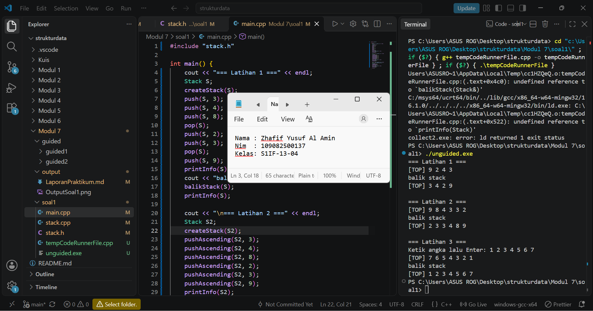

# **Laporan Praktikum MODUL 7 - STACK**

# 


Zhafif Yusuf Al Amin \- 109082500137
## Dasar Teori

### A. Konsep Dasar Stack
#### 1. Definisi Stack
Stack (tumpukan) adalah struktur data linier yang cara kerjanya seperti tumpukan barang. Data yang dimasukkan paling akhir berada di posisi paling atas, dan data itulah yang pertama kali bisa diambil. Prinsip ini disebut LIFO (Last In First Out). Akses pada stack hanya boleh dilakukan di satu sisi saja, yaitu elemen paling atas yang disebut Top. Karena itu, data di bagian tengah atau bawah tidak bisa diambil langsung, melainkan harus menunggu data di atasnya diambil terlebih dahulu.

#### 2. Perbedaan Representasi Pointer dan Tabel
Stack dapat dibuat dengan dua cara. Pada representasi pointer, stack dibuat dari node yang saling terhubung seperti singly linked list. Setiap node berisi info dan pointer next, sedangkan stack hanya menyimpan satu pointer, yaitu Top yang menunjuk ke node paling atas. Jika stack kosong, Top bernilai Nil. Ukuran stack bisa bertambah sesuai kebutuhan, tetapi memori untuk node harus dikelola sendiri dengan alokasi dan dealokasi.

Pada representasi tabel, stack dibuat dari array berindeks dan sebuah variabel Top yang menyimpan indeks elemen paling atas. Jumlah data yang bisa ditampung terbatas sesuai ukuran array, misalnya Imax. Kelebihannya, representasi ini tidak membutuhkan manajemen memori, sehingga lebih sederhana. Kekurangannya, stack bisa penuh sehingga sebelum push perlu dicek apakah masih ada tempat.

#### 3. Hubungan ADT dengan Struktur Data
Pada praktikum ini, stack diimplementasikan sebagai Abstract Data Type (ADT) yang dipisah menjadi beberapa file. File stack.h berisi definisi tipe data dan deklarasi fungsi (prototype), stack.cpp berisi implementasi fungsi-fungsi tersebut, dan main.cpp berisi program utama yang memanggil fungsi ADT. Pada representasi pointer, tipe datanya berupa struct node (berisi dataAngka dan next) dan struct stack yang berisi pointer top. Pada representasi tabel, tipe datanya berupa struct yang berisi array data dan variabel top. Dengan pemisahan ini, program utama cukup memakai fungsi yang tersedia tanpa perlu tahu cara kerja stack di dalamnya.

### B. Operasi Dasar pada Stack
#### 1. Inisialisasi dan Manajemen Memori
Fungsi createStack membuat stack dalam keadaan kosong. Pada representasi pointer, Top diisi Nil. Pada representasi tabel, Top diisi -1 (atau 0 pada modul yang menghitung indeks dari 1) sebagai tanda belum ada data. Fungsi isEmpty dipakai untuk mengecek apakah stack kosong, dan pada representasi tabel ada juga isFull untuk mengecek apakah stack sudah penuh. Khusus representasi pointer, fungsi alokasi membuat node baru secara dinamis dengan operator new lalu mengisi datanya, sedangkan fungsi dealokasi menghapus node dengan operator delete agar memori kembali ke sistem dan tidak terjadi memory leak.

#### 2. Operasi Penyisipan (Push)
Push adalah operasi menambah data ke dalam stack, dan data baru selalu masuk di posisi paling atas. Pada representasi pointer, push sama seperti insert first pada list: next node baru diarahkan ke Top yang lama, lalu Top dipindahkan ke node baru. Pada representasi tabel, Top dinaikkan satu indeks (Top = Top + 1), lalu data disimpan pada indeks tersebut. Sebelum push, stack perlu dicek dulu apakah masih ada tempat.

#### 3. Operasi Pengambilan (Pop)
Pop adalah operasi mengambil data yang berada di paling atas stack. Pada representasi pointer, pop sama seperti delete first pada list: node Top disimpan di pointer bantu, Top dipindahkan ke node berikutnya, lalu node tersebut dilepas dan dihapus dengan dealokasi. Pada representasi tabel, data di indeks Top diambil, lalu Top diturunkan satu indeks (Top = Top - 1). Data lama di array tidak dihapus, tetapi tidak dianggap bagian dari stack lagi karena berada di atas Top. Sebelum pop, stack perlu dicek dulu apakah kosong.

#### 4. Operasi Penelusuran dan Pencarian (printInfo/view dan searchData)
Fungsi printInfo atau view menampilkan seluruh isi stack mulai dari elemen paling atas sampai paling bawah. Pada representasi pointer, penelusuran dimulai dari Top mengikuti pointer next sampai Nil. Pada representasi tabel, penelusuran dimulai dari indeks Top turun sampai indeks awal. Jika stack kosong, ditampilkan pesan bahwa stack kosong. Fungsi searchData menelusuri stack dengan cara yang sama untuk mencari data tertentu, lalu menampilkan posisinya dihitung dari atas atau pesan bahwa data tidak ditemukan. Selain itu ada fungsi update untuk mengubah isi data pada posisi tertentu, serta pada latihan ada balikStack untuk membalik urutan isi stack dan pushAscending untuk menyisipkan data agar isi stack tetap terurut.

## Guided 1

### 1. Stack

source code Guided 1
stack.h
```
#ifndef STACK_TABLE
#define STACK_TABLE
#include <iostream>
using namespace std;
const int MAX = 10;

struct stackTable
{
    int data[MAX];
    int top;
};
bool isEmpty(stackTable s);
bool isFull(stackTable s);
void createStack(stackTable &s);
void push(stackTable &s, int angka);
void pop(stackTable &s); 
void update(stackTable &s, int posisi);
void view(stackTable s);
void searchData(stackTable s, int data);
#endif
```
stack.cpp
```

#include "stack.h"
#include <iostream>
using namespace std;

bool isEmpty(stackTable s)
{
    return s.top == -1;
}
bool isFull(stackTable s)
{
    return s.top == MAX - 1;
}
void createStack(stackTable &s)
{
    s.top = -1;
}
void push(stackTable &s, int angka)
{

    if (isFull(s))
    {
        cout << "Stack penuh!" << endl;
    }
    else
    {
        s.top++;
        s.data[s.top] = angka;
        cout << "Data" << angka << "berhasil ditambahkan kedalam stack !" << endl;
    }
}

void pop(stackTable &s)
{
    if (isEmpty(s))
    {
        cout << "Stack kosong!" << endl;
    }
    else
    {
        int val = s.data[s.top];
        s.top--;
        cout << "Data" << val << " berhasil dihapus dari stack!" << endl;
    }
}

void update(stackTable &s, int posisi)
{
    if (isEmpty(s))
    {
        cout << "Stack kosong!" << endl;
    }
    if (posisi <= 0)
    {
        cout << "Posisi tidak valid!" << endl;
        return;
    }
    // index = top

    int idx = s.top - (posisi - 1);
    if (idx < 0 || idx > s.top)
    {
        cout << "Posisi " << posisi << " tidak valid!" << endl;
        return;
    }

    cout << "Update data posisi ke-" << posisi << endl;
    cout << "Masukkan angka : ";
    cin >> s.data[idx];
    cout << "Data berhasil diupdate!" << endl;
    cout << endl;
}

void view(stackTable s)
{
    if (isEmpty(s))
    {
        cout << "Stack kosong!" << endl;
    }
    else
    {
        for (int i = s.top; i >= 0; --i)
        {
            cout << s.data[i] << " ";
        }
    }
    cout << endl;
}

void searchData(stackTable s, int data)
{
    if (isEmpty(s))
    {
        cout << "Stack kosong!" << endl;
        return;
    }

    cout << "Mencari data " << data << "..." << endl;
    int posisi = 1;
    bool found = false;

    for (int i = s.top; i >= 0; --i)
    {
        if (s.data[i] == data)
        {
            cout << "Data " << data << " ditemukan pada posisi ke-" << posisi << endl;
            cout << endl;
            found = true;
            break;
        }
        posisi++;
    }

    if (!found)
    {
        cout << "Data " << data << " tidak ditemukan didalam stack!" << endl;
        cout << endl;
    }
}

```
main.cpp
```
#include "stack.h"
#include <iostream>

using namespace std;

int main()
{
    stackTable s;
    createStack(s);

    push(s, 1);
    push(s, 2);
    push(s, 3);
    push(s, 4);
    push(s, 5);
    cout << endl;

    cout << "--- Stack setelah push ---" << endl;
    view(s);
    cout << endl;

    pop(s);
    pop(s);
    cout << endl;

    cout << "--- Stack setelah pop 2 kali ---" << endl;
    view(s);
    cout << endl;

    update(s, 2);
    update(s, 1);
    cout << endl;

    cout << "--- Stack setelah update ---" << endl;
    view(s);
    cout << endl;

    searchData(s, 4);
    searchData(s, 9);

    return 0;
}
```
Program ini membuat stack dengan representasi tabel (array). Stack bertipe stackTable yang berisi array data berukuran MAX = 10 dan variabel top, dengan top = -1 sebagai tanda stack kosong. Di main, stack dibuat dengan createStack lalu diisi angka 1 sampai 5 memakai push, sehingga angka 5 berada di paling atas. Isi stack ditampilkan dengan view dari atas ke bawah. Setelah itu dilakukan pop dua kali yang mengambil angka 5 dan 4 secara berurutan, lalu isi stack ditampilkan lagi. Data kemudian diubah dengan update pada posisi ke-2 dan ke-1 (dihitung dari atas) sesuai angka yang diinputkan, dan hasilnya ditampilkan kembali. Terakhir, searchData dipakai untuk mencari angka 4 dan 9 dan menampilkan posisinya atau pesan bahwa data tidak ditemukan. Fungsi isFull dan isEmpty dipakai untuk mencegah push saat stack penuh dan pop saat stack kosong.

## Guided 2

### 2. Stack

source code Guided 1
stack.h
```
#ifndef STACK
#define STACK
#define Nil NULL

#include <iostream>
using namespace std;
const int MAX = 10;

typedef struct node *address;

struct node
{
    int dataAngka;
    address next;
};

struct stack
{
    address top;
};

bool isEmpty(stack listStack);
void createStack(stack &listStack);
address alokasi(int angka);
void dealokasi(addresss &node);

void push(stack &listStack, address nodeBaru);
void pop(stack &listStack); 
void update(stack &listStack, int posisi);
void view(stack &listStack);
void searchData(stack listStack, int data);
#endif
```
stack.cpp
```
#include "stack.h"
#include <iostream>

using namespace std;

bool isEmpty(stack listStack)
{
    if (listStack.top == Nil)
    {
        return true;
    }
    else
    {
        return false;
    }
}

void createStack(stack &listStack)
{
    listStack.top = Nil;
}

address alokasi(int angka)
{
    address nodeBaru = new node;
    nodeBaru->dataAngka = angka;
    nodeBaru->next = Nil;
    return nodeBaru;
}

void dealokasi(address &node)
{
    node->next = Nil;
    delete node;
}

void push(stack &listStack, address nodeBaru)
{
    nodeBaru->next = listStack.top;
    listStack.top = nodeBaru;
    cout << "Node " << nodeBaru->dataAngka << " berhasil ditambahkan kedalam stack!" << endl;
}

void pop(stack &listStack)
{
    address nodeHapus;
    if (isEmpty(listStack) == true)
    {
        cout << "Stack kosong!" << endl;
    }
    else
    {
        nodeHapus = listStack.top;
        listStack.top = listStack.top->next;
        nodeHapus->next = Nil;
        dealokasi(nodeHapus);
        cout << "node " << nodeHapus->dataAngka << " berhasil dihapus dari stack!" << endl;
    }
}

void update(stack &listStack, int posisi)
{
    if (isEmpty(listStack) == true)
    {
        cout << "Stack kosong!" << endl;
    }
    else
    {
        if (posisi == 0)
        {
            cout << "Posisi tidak valid!" << endl;
        }
        else
        {
            address nodeBantu = listStack.top;
            int count = 1;
            bool found = false;
            while (nodeBantu != Nil)
            {
                if (count < posisi)
                {
                    nodeBantu = nodeBantu->next;
                    count++;
                }
                else if (count == posisi)
                {
                    cout << "Update node poisisi ke-" << posisi << endl;
                    cout << "Masukkan angka : ";
                    cin >> nodeBantu->dataAngka;
                    cout << "Data berhasil diupdate!" << endl;
                    cout << endl;
                    found = true;
                    break;
                }
            }
            if (found == false)
            {
                cout << "Posisi " << posisi << " tidak valid!" << endl;
            }
        }
    }
}

void view(stack listStack)
{
    if (isEmpty(listStack) == true)
    {
        cout << "List kosong!" << endl;
    }
    else
    {
        address nodeBantu = listStack.top;
        while (nodeBantu != Nil)
        {
            cout << nodeBantu->dataAngka << " ";
            nodeBantu = nodeBantu->next;
        }
    }
    cout << endl;
}

void searchData(stack listStack, int data)
{
    if (isEmpty(listStack) == true)
    {
        cout << "List kosong!" << endl;
    }
    else
    {
        address nodeBantu = listStack.top;
        int posisi = 1;
        bool found = false;
        cout << "Mencari data " << data << "..." << endl;
        while (nodeBantu != Nil)
        {
            if (nodeBantu->dataAngka == data)
            {
                cout << "Data " << data << " ditemukan pada posisi ke-" << posisi << endl;
                found = true;
                cout << endl;
                break;
            }
            else
            {
                posisi++;
                nodeBantu = nodeBantu->next;
            }
        }
        if (found == false)
        {
            cout << "Data " << data << " tidak ditemukan didalam stack!" << endl;
            cout << endl;
        }
    }
}
```
main.cpp
```
#include "stack.h"
#include <iostream>

using namespace std;

int main()
{
    stack listStack;
    address nodeA, nodeB, nodeC, nodeD, nodeE = Nil;
    createStack(listStack);

    nodeA = alokasi(1);
    nodeB = alokasi(2);
    nodeC = alokasi(3);
    nodeD = alokasi(4);
    nodeE = alokasi(5);

    push(listStack, nodeA);
    push(listStack, nodeB);
    push(listStack, nodeC);
    push(listStack, nodeD);
    push(listStack, nodeE);
    cout << endl;

    cout << "--- Stack setelah push ---" << endl;
    view(listStack);
    cout << endl;

    pop(listStack);
    pop(listStack);
    cout << endl;

    cout << "--- Stack setelah pop 2 kali ---" << endl;
    view(listStack);
    cout << endl;

    update(listStack, 2);
    update(listStack, 1);
    update(listStack, 4);
    cout << endl;

    cout << "--- Stack setelah update ---" << endl;
    view(listStack);
    cout << endl;

    searchData(listStack, 4);
    searchData(listStack, 9);

    return 0;
}
```
Program ini membuat stack dengan representasi pointer. Stack terdiri dari node (berisi dataAngka dan next) dan satu pointer top yang menunjuk ke node paling atas, dengan top = Nil sebagai tanda stack kosong. Di main, stack dibuat dengan createStack, lalu lima node dibuat dengan alokasi (angka 1 sampai 5) dan dimasukkan satu per satu dengan push. Setiap push bekerja seperti insert first, sehingga node terakhir (5) berada di paling atas. Isi stack ditampilkan dengan view dari top mengikuti pointer next. Setelah itu dilakukan pop dua kali yang melepas node paling atas dan menghapusnya dari memori dengan dealokasi, lalu isi stack ditampilkan lagi. Data diubah dengan update pada posisi ke-2, ke-1, dan ke-4. Karena setelah dua kali pop hanya tersisa tiga node, posisi ke-4 menghasilkan pesan posisi tidak valid. Terakhir, searchData dipakai untuk mencari angka 4 dan 9 dan menampilkan posisinya atau pesan bahwa data tidak ditemukan.

## Unguided

### 1\.

source code unguided 1
stack.h
```
#ifndef STACK_H_INCLUDED
#define STACK_H_INCLUDED

#include <iostream>
using namespace std;

typedef int infotype;

struct Stack {
    infotype info[20];  
    int top;            
};

void createStack(Stack &S);
void push(Stack &S, infotype x);
infotype pop(Stack &S);
void printInfo(Stack S);
void balikStack(Stack &S);
void pushAscending(Stack &S, infotype x);
void getInputStream(Stack &S);

#endif 
```
stack.cpp
```
#include "stack.h"

void createStack(Stack &S) {
    S.top = -1;
}

void push(Stack &S, infotype x) {
    if (S.top < 19) {          
        S.top++;
        S.info[S.top] = x;
    } else {
        cout << "Stack penuh!" << endl;
    }
}

infotype pop(Stack &S) {
    if (S.top == -1) {        
        cout << "Stack kosong!" << endl;
        return -1;
    }
    infotype x = S.info[S.top];
    S.top--;
    return x;
}

void printInfo(Stack S) {
    cout << "[TOP] ";
    for (int i = S.top; i >= 0; i--) {
        cout << S.info[i] << " ";
    }
    cout << endl;
}

void balikStack(Stack &S) {
    int kiri = 0;
    int kanan = S.top;
    while (kiri < kanan) {
        infotype temp = S.info[kiri];
        S.info[kiri] = S.info[kanan];
        S.info[kanan] = temp;
        kiri++;
        kanan--;
    }
}

void pushAscending(Stack &S, infotype x) {
    if (S.top >= 19) {
        cout << "Stack penuh!" << endl;
        return;
    }

    int posisi = 0;
    while (posisi <= S.top && S.info[posisi] <= x) {
        posisi++;
    }
    
    for (int i = S.top; i >= posisi; i--) {
        S.info[i + 1] = S.info[i];
    }
    S.info[posisi] = x;
    S.top++;
}

void getInputStream(Stack &S) {
    char c = cin.get();
    while (c != '\n') {
        if (c >= '0' && c <= '9') {
            push(S, c - '0');  
        }
        c = cin.get();
    }
}
```
main.cpp
```
#include "stack.h"

int main() {
    cout << "=== Latihan 1 ===" << endl;
    Stack S;
    createStack(S);
    push(S, 3);
    push(S, 4);
    push(S, 8);
    pop(S);
    push(S, 2);
    push(S, 3);
    pop(S);
    push(S, 9);
    printInfo(S);
    cout << "balik stack" << endl;
    balikStack(S);
    printInfo(S);

    cout << "\n=== Latihan 2 ===" << endl;
    Stack S2;
    createStack(S2);
    pushAscending(S2, 3);
    pushAscending(S2, 4);
    pushAscending(S2, 8);
    pushAscending(S2, 2);
    pushAscending(S2, 3);
    pushAscending(S2, 9);
    printInfo(S2);
    cout << "balik stack" << endl;
    balikStack(S2);
    printInfo(S2);

    cout << "\n=== Latihan 3 ===" << endl;
    cout << "Ketik angka lalu Enter: ";
    Stack S3;
    createStack(S3);
    getInputStream(S3);
    printInfo(S3);
    cout << "balik stack" << endl;
    balikStack(S3);
    printInfo(S3);

    return 0;
}
```
### Output Unguided 1 :

##### Output 1



Program ini membuat ADT Stack dengan representasi tabel (array) yang dipisah ke stack.h, stack.cpp, dan main.cpp. Tipe data stack berisi array info berukuran 20 bertipe integer dan variabel top, dengan top = -1 sebagai tanda stack kosong. Pada latihan 1, stack diisi dan diambil dengan push dan pop sesuai urutan di soal, lalu isinya ditampilkan dengan printInfo dari atas (TOP) ke bawah. Setelah itu balikStack membalik urutan isi stack dengan cara menukar data dari ujung kiri dan kanan, lalu isinya ditampilkan lagi. Pada latihan 2, ditambahkan prosedur pushAscending yang mencari tempat yang pas untuk data baru, menggeser data yang lebih besar ke atas, lalu menyisipkan data tersebut, sehingga isi stack selalu terurut dengan data terbesar di paling atas. Pada latihan 3, ditambahkan prosedur getInputStream yang membaca input dengan cin.get() terus-menerus sampai user menekan Enter, lalu setiap angka yang diketik dimasukkan ke dalam stack. Pada tiap latihan, isi stack ditampilkan sebelum dan sesudah dibalik untuk memastikan hasilnya sesuai.

## Kesimpulan
Dari praktikum Modul 7, saya jadi paham bahwa stack adalah struktur data yang bekerja dengan prinsip LIFO (Last In First Out), di mana data hanya bisa dimasukkan dan diambil dari satu sisi, yaitu Top. Lewat dua representasi, yaitu pointer dan tabel (array), saya belajar bahwa konsepnya sama tetapi caranya berbeda. Representasi pointer butuh alokasi dan dealokasi memori, sedangkan representasi tabel lebih sederhana tetapi kapasitasnya terbatas sehingga perlu dicek penuh atau tidaknya. Lewat ADT yang dibuat di stack.h, stack.cpp, dan main.cpp, saya belajar membuat stack dengan createStack, menambah data dengan push, mengambil data dengan pop, menampilkan data dengan printInfo atau view, serta mencari dan mengubah data. Pada latihan, saya juga belajar membalik isi stack dengan balikStack, menjaga isi stack tetap terurut dengan pushAscending, dan membaca input sampai Enter dengan getInputStream. Yang paling penting, saya harus teliti menjaga nilai Top (atau pointer top) supaya tidak terjadi pop pada stack kosong atau push pada stack yang penuh.

## Referensi
Laboratorium Informatika Telkom University. (2026). Modul 07 Praktikum Struktur Data: Stack. Bandung: Fakultas Informatika Telkom University.

Cormen, T. H., Leiserson, C. E., Rivest, R. L., & Stein, C. (2009). Introduction to Algorithms (3rd ed.). MIT Press.

Stroustrup, B. (2013). The C++ Programming Language (4th ed.). Addison-Wesley.