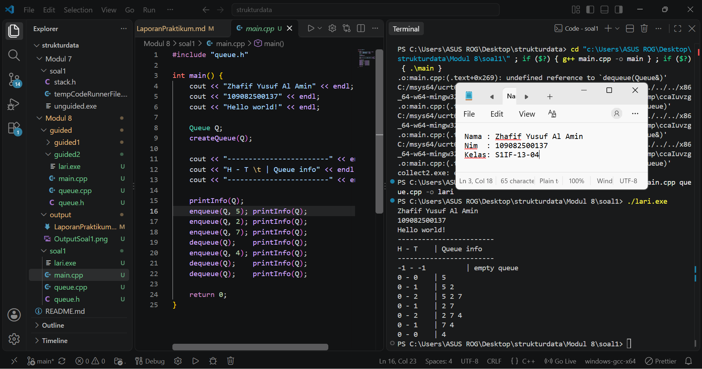

# **Laporan Praktikum MODUL 8 - QUEUE**

# 

Zhafif Yusuf Al Amin \- 109082500137
## Dasar Teori

### A. Konsep Dasar Queue
#### 1. Definisi Queue
Queue (antrian) adalah struktur data linier yang cara kerjanya seperti antrian di loket. Data yang masuk lebih dulu akan keluar lebih dulu. Prinsip ini disebut FIFO (First In First Out). Data dimasukkan lewat satu sisi yang disebut Tail (belakang) dan diambil lewat sisi lain yang disebut Head (depan). Karena itu, data di tengah antrian tidak bisa diambil langsung, harus menunggu data di depannya keluar terlebih dahulu.

#### 2. Perbedaan Representasi Pointer dan Tabel
Queue dapat dibuat dengan dua cara. Pada representasi pointer, queue dibuat dari node yang saling terhubung seperti singly linked list. Setiap node berisi info dan pointer next, sedangkan queue menyimpan dua pointer, yaitu Head yang menunjuk ke node paling depan dan Tail yang menunjuk ke node paling belakang. Jika queue kosong, Head dan Tail bernilai Nil. Ukurannya bisa bertambah sesuai kebutuhan, tetapi memori node harus dikelola sendiri dengan new dan delete.

Pada representasi tabel, queue dibuat dari array dan dua variabel indeks, yaitu Head dan Tail. Jumlah data yang bisa ditampung terbatas sesuai ukuran array, sehingga sebelum enqueue perlu dicek apakah queue sudah penuh. Representasi tabel punya tiga cara kerja:

Head diam, Tail bergerak (linear statis): Head selalu di indeks 0. Saat dequeue, semua elemen digeser ke depan.
Head dan Tail sama-sama bergerak (linear dinamis): Saat dequeue, Head maju satu indeks tanpa menggeser elemen.
Head dan Tail berputar (circular): Jika Tail sudah di ujung array tetapi masih ada ruang kosong di depan, Tail kembali ke indeks awal.

#### 3. Hubungan ADT dengan Struktur Data
Pada praktikum ini, queue diimplementasikan sebagai Abstract Data Type (ADT) yang dipisah menjadi beberapa file. File queue.h berisi definisi tipe data dan deklarasi fungsi (prototype), queue.cpp berisi implementasi fungsi-fungsi tersebut, dan main.cpp berisi program utama yang memanggil fungsi ADT. Pada representasi pointer, tipe datanya berupa struct Node (berisi nama dan next) dan struct queue yang berisi pointer head dan tail. Pada representasi tabel, tipe datanya berupa struct yang berisi array data serta variabel head dan tail. Dengan pemisahan ini, program utama cukup memakai fungsi yang tersedia tanpa perlu tahu cara kerja queue di dalamnya.

### B. Operasi Dasar pada Queue
#### 1. Inisialisasi dan Manajemen Memori
Fungsi CreateQueue membuat queue dalam keadaan kosong. Pada representasi pointer, Head dan Tail diisi nullptr. Pada representasi tabel, Head dan Tail diisi -1 sebagai tanda belum ada data. Fungsi isEmpty dipakai untuk mengecek apakah queue kosong, dan isFull untuk mengecek apakah queue sudah penuh. Pada representasi pointer, node dibuat secara dinamis dengan operator new dan dihapus dengan operator delete agar memori kembali ke sistem dan tidak terjadi memory leak.

#### 2. Operasi Penyisipan (Enqueue)
Enqueue adalah operasi menambah data ke dalam queue, dan data baru selalu masuk di posisi paling belakang. Jika queue masih kosong, Head dan Tail sama-sama menunjuk ke data baru. Jika sudah berisi, pada representasi pointer next dari Tail lama diarahkan ke node baru lalu Tail dipindahkan ke node baru, sedangkan pada representasi tabel Tail dinaikkan satu indeks lalu data disimpan di indeks tersebut. Sebelum enqueue pada representasi tabel, queue perlu dicek dulu apakah sudah penuh.

#### 3. Operasi Pengambilan (Dequeue)
Dequeue adalah operasi mengambil data yang berada di paling depan queue. Pada representasi pointer, node Head disimpan di pointer bantu, Head dipindahkan ke node berikutnya, lalu node tersebut dihapus. Pada representasi tabel, caranya tergantung implementasi: pada Head diam, semua elemen digeser ke depan dan Tail dikurangi satu, sedangkan pada Head bergerak, Head cukup dimajukan satu indeks. Jika elemen sudah habis, Head dan Tail dikembalikan ke -1. Sebelum dequeue, queue perlu dicek dulu apakah kosong.

#### 4. Operasi Penelusuran (printInfo/viewQueue)
Fungsi printInfo atau viewQueue menampilkan seluruh isi queue mulai dari elemen paling depan (Head) sampai paling belakang (Tail). Pada representasi pointer, penelusuran dimulai dari Head mengikuti pointer next sampai nullptr. Pada representasi tabel, penelusuran dimulai dari indeks Head sampai indeks Tail. Jika queue kosong, ditampilkan pesan bahwa queue kosong.

## Guided 1

### 1. Queue

source code Guided 1
queue.h
```
#ifndef QUEUE_H
#define QUEUE_H

#include <iostream>
#include <string>
using namespace std;


struct Node
{
    string nama;
    Node *next;
};
struct queue
{
    Node *head, *tail;
};
void CreateQueue(queue &Q);
bool isEmpty(queue Q);
bool isFull(queue Q);
void enQueue(queue &Q, const string &nama);
void deQueue(queue &Q);
void viewQueue(queue Q);
void clearQueue(queue &Q);
#endif
```
queue.cpp
```
#include "queue.h"

void CreateQueue(queue &Q)
{
    Q.head = Q.tail =nullptr;
}

bool isEmpty(queue Q)
{
    return Q.head==nullptr && Q.tail==nullptr;
}

bool isFull(queue Q)
{
    int maxQueue = 20;
    int counter = 0;
    Node *nodeBantu = Q.head;
    while (nodeBantu != Q.tail)
    {
        counter ++;
        nodeBantu->next;
    }
    return counter >= maxQueue;
    
}

void enQueue(queue &Q, const string &nama)
{
    if (isEmpty(Q))
    {
        Node *nodeBaru = new Node{nama,nullptr};
        Q.head = Q.tail = nodeBaru;
    }else{

        Node *nodeBaru=new Node{nama, nullptr};
        Q.tail->next = nodeBaru;
        Q.tail =nodeBaru;
    }
}

void deQueue(queue &Q)
{
    if (isEmpty(Q))
    {
        cout<<"Queue kosong";
    }else{
        Node *nodeHapus =Q.head;
        Q.head=Q.head->next;
        delete nodeHapus;
    }
}

void viewQueue(queue Q)
{
    if (isEmpty(Q))
    {
        cout<<"Queue kosong";
    }else{
        Node *nodeBantu= Q.head;

        while (nodeBantu!=nullptr){
            cout<<"Nama : " << nodeBantu->nama<<endl;
            nodeBantu=nodeBantu->next;
        }
    }
}

void clearQueue(queue &Q)
{
    if (isEmpty(Q))
    {
        cout<<"Queue kosong";
    }else{
        Node *nodeHapus = Q.head;

        while (nodeHapus!=nullptr)
        {
            nodeHapus=nodeHapus->next;
            deQueue(Q);
        }
        
    }
    
}
```
main.cpp
```
#include "queue.h"
#include <iostream>
using namespace std;

int main()
{
    queue Q;
    CreateQueue(Q);

    enQueue(Q, "Gilar ");
    enQueue(Q, "Aflah ");
    enQueue(Q, "Aedil ");
    enQueue(Q, "Fathir ");
    enQueue(Q, "Kevin ");
    enQueue(Q, "Zulfa ");
    cout<<endl;

    cout<<"--isi Queue Setelah enQueue---"<<endl;
    viewQueue(Q);

    deQueue(Q);
    deQueue(Q);
    deQueue(Q);
    deQueue(Q);
    cout<<endl;

    cout<<"--Isi Queue Setelah deQueue--"<<endl;
    viewQueue(Q);

    clearQueue;
    return 0;
    
}
```
sebuah program yang dimana antrian nama dibuat dengan representasi pointer (single linked list) memakai head dan tail. Ada enam nama yang dimasukkan dengan enQueue, lalu isinya ditampilkan dengan viewQueue. Setelah itu dilakukan deQueue sebanyak empat kali sehingga empat nama paling depan keluar, dan isi queue ditampilkan lagi yang tersisa dua nama terakhir.

## Guided 2

### 2. queue

source code Guided 1
queue.h
```
#ifndef QUEUE_H
#define QUEUE_H

#include <iostream>
using namespace std;

const int MAKSIMAL = 5;

struct queue {
    string nama[MAKSIMAL];
    int head;
    int tail;
};

bool isFull(queue Q);
bool isEmpty(queue Q);
void CreateQueue(queue &Q);
void enQueue(queue &Q, string nama);
void deQueue(queue &Q);
void viewQueue(queue Q);

#endif
```
queue.cpp
```
#include "queue.h"
#include <iostream>

using namespace std;

// NOTE : 
// Implementasi 1 = head diam, tail bergerak (Queue Linear Statis, kerana head nya tetap diam)
// Implementasi 2 = head bergerak, tail bergerak (Queue Linear Dinamis, karena head & tail nya sama-sama bergerak)
// Implementasi 3 = head dan tail berputar (Queue Circular, karena jika udh mentok tapi masih ada space, diputar sehingga tail bisa ada didepan head)

bool isEmpty(queue Q){
    if(Q.head == -1 && Q.tail == -1){
        return true;
    } else {
        return false;
    }
}

//isFull implmenetasi 1 & 2
bool isFull(queue Q){
    if(Q.tail == MAKSIMAL - 1){
        return true;
    } else {
        return false;
    }
}

// //isFull implementasi 3
// bool isFull(queue Q){
//     if((Q.tail + 1) % MAKSIMAL == Q.head){
//         return true;
//     } else {
//         return false;
//     }
// }

void CreateQueue(queue &Q){ //terbentuk queue dengan head = -1 dan tail = -1 
    Q.head = -1;
    Q.tail = -1;
}
 

//enqueue implementasi 1 & 2
void enQueue(queue &Q, string nama){
    if(isFull(Q) == true){
        cout << "Queue sudah penuh!" << endl;
    } else {
        if(isEmpty(Q) == true){
            Q.head = Q.tail = 0;
        } else {
            Q.tail++;
        }
        Q.nama[Q.tail] = nama;
        cout << "nama " << nama << " berhasil ditambahkan kedalam queue!" << endl;
    }
}

// //enQueue implementasi 3
// void enQueue(queue &Q, string nama){
//     if(isFull(Q) == true){
//         cout << "Queue sudah penuh!" << endl;
//     } else {
//         if(isEmpty(Q) == true){
//             Q.head = Q.tail = 0;
//         } else {
//             Q.tail = (Q.tail + 1) % MAKSIMAL; // bergerak melingkar
//         }
//         Q.nama[Q.tail] = nama;
//         cout << "nama " << nama << " berhasil ditambahkan kedalam queue!" << endl;
//     }
// }

//dequeue implementasi 1
void deQueue(queue &Q){
    if(isEmpty(Q) == true){
        cout << "Queue kosong!" << endl;
    } else {
        cout << "Mengahapus data " << Q.nama[Q.head] << "..." << endl;
        for(int i = 0; i < Q.tail; i++){
            Q.nama[i] =  Q.nama[i+1];
        }
        Q.tail--;
        if(Q.tail < 0){ //kalo semua isi queue nya udh dikeluarin, set head & tail ke -1
            Q.head = -1;
            Q.tail = -1;
        }
    }
}

// //dequeue implementasi 2
// void deQueue(queue &Q){
//     if(isEmpty(Q) == true){
//         cout << "Queue kosong!" << endl;
//     } else {
//         cout << "Mengahapus data " << Q.nama[Q.head] << "..." << endl;
//         Q.head++;
//         if(Q.head > Q.tail){ //kalo elemennya udh abis (head akan lebih 1 dari tail), maka reset ulang head & tail ke -1
//             Q.head = -1;
//             Q.tail = -1;
//         }
//     }
// }

// //deQueue implementasi 3
// void deQueue(queue &Q){
//     if(isEmpty(Q) == true){
//         cout << "Queue kosong!" << endl;
//     } else {
//         cout << "Mengahapus data " << Q.nama[Q.head] << "..." << endl;
//         if(Q.head == Q.tail){ //kalo elemennya tinggal 1, langsungkan saja head & tail nya reset ke -1
//             Q.head = -1;
//             Q.tail = -1;
//         } else {
//             Q.head = (Q.head + 1) % MAKSIMAL; // bergerak melingkar
//         }
//     }
// }

//viewQueue implementasi 1 & 2
void viewQueue(queue Q){
    if(isEmpty(Q) == true){
        cout << "Queue kosong!" << endl;
    } else {
        for(int i = Q.head; i <= Q.tail; i++){
            cout << i -  Q.head + 1 << ". " << Q.nama[i] << endl;
        }
    }
    cout << endl;
}

// //viewQueue implementasi 3
// void viewQueue(queue Q){
//     if(isEmpty(Q) == true){
//         cout << "Queue kosong!" << endl;
//     } else {
//         int i = Q.head;
//         int count = 1;
//         while(true){
//             cout << count << ". " << Q.nama[i] << endl;
//             if(i == Q.tail){
//                 break;
//             }
//             i = (i + 1) % MAKSIMAL;
//             count++;
//         }   
//     }
// }
```
main.cpp
```
#include "queue.h"
#include <iostream>

using namespace std;

int main(){
    queue Q;

    CreateQueue(Q);
    enQueue(Q, "Dimas");
    enQueue(Q, "Arvin");
    enQueue(Q, "Rizal");
    enQueue(Q, "Hafizh");
    enQueue(Q, "Fathur");
    enQueue(Q, "Daffa");
    cout << endl;

    cout << "--- Isi Queue Setelah enQueue ---" << endl;
    viewQueue(Q);
    cout << endl;

    deQueue(Q);
    deQueue(Q);
    deQueue(Q);
    deQueue(Q);
    // deQueue(Q);
    // deQueue(Q);
    cout << endl;

    cout << "--- Isi Queue Setelah deQueue ---" << endl;
    viewQueue(Q);

    return 0;
}
```
sebuah program yang dimana antrian nama dibuat dengan representasi tabel (array) berukuran 5, memakai implementasi 1 yaitu head diam dan tail bergerak. Ada enam nama yang dimasukkan dengan enQueue, tetapi nama keenam ditolak dengan pesan “Queue sudah penuh!” karena kapasitasnya hanya 5. Setelah viewQueue, dilakukan deQueue sebanyak empat kali, di mana setiap kali dequeue elemen digeser ke depan, sehingga yang tersisa hanya satu nama.

## Unguided

### 1\.

source code unguided 1
queue.h
```
#ifndef QUEUE_H
#define QUEUE_H

#include <iostream>

using namespace std;

typedef int infotype;
struct Queue {
    infotype info[5];
    int head;
    int tail;
};

void createQueue(Queue &Q);
bool isEmptyQueue(Queue Q);
bool isFullQueue(Queue Q);
void enqueue(Queue &Q, infotype x);
infotype dequeue(Queue &Q);
void printInfo(Queue Q);

#endif
```
queue.cpp
```
#include "queue.h"

void createQueue(Queue &Q) {
    Q.head = -1;
    Q.tail = -1;
}

bool isEmptyQueue(Queue Q) {
    if (Q.head == -1 && Q.tail == -1) {
        return true;
    } else {
        return false;
    }
}

bool isFullQueue(Queue Q) {
    if (Q.tail == 4) {
        return true;
    } else {
        return false;
    }
}

void enqueue(Queue &Q, infotype x) {
    if (isFullQueue(Q)) {
        cout << "Queue penuh!" << endl;
    } else {
        if (isEmptyQueue(Q)) {
            Q.head = 0;
            Q.tail = 0;
            Q.info[Q.tail] = x;
        } else {
            Q.tail = Q.tail + 1;
            Q.info[Q.tail] = x;
        }
    }
}

infotype dequeue(Queue &Q) {
    infotype x = -999;
    if (isEmptyQueue(Q)) {
        cout << "Queue kosong!" << endl;
    } else {
        x = Q.info[Q.head];
        if (Q.head == Q.tail) {
            // Jika elemen tinggal 1, reset ke kondisi kosong (-1)
            Q.head = -1;
            Q.tail = -1;
        } else {
            // Mekanisme Alternatif 1: Head diam, elemen digeser ke depan
            for (int i = Q.head; i < Q.tail; i++) {
                Q.info[i] = Q.info[i + 1];
            }
            Q.tail = Q.tail - 1;
        }
    }
    return x;
}

void printInfo(Queue Q) {
    cout << Q.head << " - " << Q.tail << " \t | ";
    if (isEmptyQueue(Q)) {
        cout << "empty queue";
    } else {
        for (int i = Q.head; i <= Q.tail; i++) {
            cout << Q.info[i] << " ";
        }
    }
    cout << endl;
}
```
main.cpp
```
#include "queue.h"

int main() {
    cout << "Zhafif Yusuf Al Amin" << endl;
    cout << "109082500137" << endl;
    cout << "Hello world!" << endl;

    Queue Q;
    createQueue(Q);

    cout << "------------------------" << endl;
    cout << "H - T \t | Queue info" << endl;
    cout << "------------------------" << endl;

    printInfo(Q);
    enqueue(Q, 5); printInfo(Q);
    enqueue(Q, 2); printInfo(Q);
    enqueue(Q, 7); printInfo(Q);
    dequeue(Q);    printInfo(Q);
    enqueue(Q, 4); printInfo(Q);
    dequeue(Q);    printInfo(Q);
    dequeue(Q);    printInfo(Q);

    return 0;
}
```
### Output Unguided 1 :

##### Output 1



Sebuah program yang dimana ADT Queue dengan representasi tabel (array berukuran 5) dibuat di queue.h, queue.cpp, dan main.cpp dengan mekanisme head diam dan tail bergerak. Fungsi yang dibuat adalah createQueue, isEmptyQueue, isFullQueue, enqueue, dequeue, dan printInfo. Di main.cpp, program menjalankan urutan enqueue 5, 2, 7, dequeue, enqueue 4, lalu dequeue dua kali. Setiap langkahnya langsung ditampilkan dengan printInfo dalam format H - T | isi queue, sehingga perubahan posisi head, tail, dan isi queue bisa terlihat. program menampilkan nama dan NIM, lalu tabel dengan kolom H - T dan Queue info. Awalnya queue kosong (-1 - -1). Setelah enqueue 5, 2, dan 7, isinya 5 2 7 dengan head 0 dan tail 2. Setelah dequeue, angka 5 keluar dan isinya menjadi 2 7. Setelah enqueue 4, isinya 2 7 4. Dua dequeue berikutnya mengeluarkan 2 dan 7, sehingga tersisa 4 dengan head dan tail sama-sama 0.

## Kesimpulan 
Dari praktikum Modul 8, dipahami bahwa queue adalah struktur data dengan prinsip FIFO (First In First Out), di mana data masuk lewat belakang (tail) dan keluar lewat depan (head). Lewat representasi pointer dan tabel (array), dipelajari bahwa konsepnya sama tetapi caranya berbeda, yaitu pointer perlu pengelolaan memori sedangkan tabel kapasitasnya terbatas sehingga perlu dicek penuh atau tidaknya. Lewat ADT yang dibuat di queue.h, queue.cpp, dan main.cpp, dipelajari cara membuat queue, menambah data dengan enqueue, mengambil data dengan dequeue, dan menampilkan data dengan printInfo. Yang paling penting, posisi head dan tail harus dijaga dengan teliti supaya tidak terjadi dequeue pada queue kosong atau enqueue pada queue yang penuh.

## Referensi 
Laboratorium Informatika Telkom University. (2026). Modul 07 Praktikum Struktur Data: Queue. Bandung: Fakultas Informatika Telkom University.

Cormen, T. H., Leiserson, C. E., Rivest, R. L., & Stein, C. (2009). Introduction to Algorithms (3rd ed.). MIT Press.

Stroustrup, B. (2013). The C++ Programming Language (4th ed.). Addison-Wesley.

